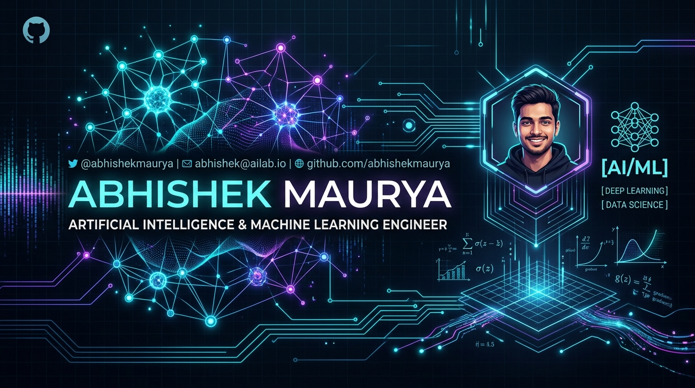

<div align="center">

  <!-- Main Hero Banner -->
  

  <br/><br/>

  <!-- Dynamic Typing SVG Header -->
  <a href="https://github.com/AbhishekCodingPrograms">
    
  </a>

  <br/><br/>

  <!-- Status & Capsule Badges -->
  <p align="center">
    
    
    
    
  </p>

  <!-- Social Connect Quick-Bar -->
  <p align="center">
    <a href="mailto:abhishekmaurya2104567@gmail.com" target="_blank">
      
    </a>
    <a href="https://github.com/AbhishekCodingPrograms" target="_blank">
      
    </a>
    <a href="https://abhishekcodingprograms.github.io/abhishekmaurya_portfolio/" target="_blank">
      
    </a>
    <a href="https://www.hackerrank.com/profile/AbhishekCodingPrograms" target="_blank">
      
    </a>
  </p>

</div>

---

### 🚀 About Me

```yaml
name: Abhishek Maurya
role: Artificial Intelligence & Machine Learning Engineer
education: B.Tech in CSE (Artificial Intelligence & Machine Learning) @ AKGEC
focus: Computer Vision, Deep Learning, Kinematics AI, NLP Pipelines
dsa_problems_solved: 200+
status: Open for SDE / AI / ML Engineering Roles & High-Impact Collaborations
philosophy: "Architecting intelligent systems that perceive, predict, and empower."
```

- 🔭 **Currently Building**: **AIFit** — A real-time kinematic posture analysis & form-correction engine powered by MediaPipe and custom ML classifiers.
- 🖐️ **Recent Innovation**: **VisionMouse** — An AI-driven touchless virtual mouse allowing computer control through high-precision hand gesture landmarks.
- 🧠 **Research & Core Focus**: Deep Convolutional Neural Networks (CNNs), Kinematic Landmark Topology, Natural Language Sentiment Analysis, and End-to-End Machine Learning Deployment.
- ⚡ **Competitive Problem Solving**: Solved **200+ Data Structures & Algorithms** problems strengthening algorithmic efficiency and system design.
- 🎯 **What I Seek**: Building cutting-edge AI software products, collaborating on open-source repositories, and driving data-driven innovation.

---

### 🛠️ Tech Stack & Capabilities

<div align="center">

| Domain | Technologies & Frameworks |
| :--- | :--- |
| **Languages** |        |
| **AI / ML & Deep Learning** |       |
| **Computer Vision & NLP** |      |
| **Data Viz & Analytics** |    |
| **Backend & Full-Stack** |      |
| **DevOps, Databases & Tools** |       |

</div>

---

### ⭐ Featured Projects

<table>
  <tr>
    <td width="50%" valign="top">
      <h3 align="center">🖐️ VisionMouse — AI Gesture Virtual Mouse</h3>
      <p align="center">
        
        
      </p>
      <p>
        A touchless, real-time Human-Computer Interaction (HCI) solution that translates hand gestures into smooth, responsive mouse movements and click interactions using multi-point hand landmark tracking.
      </p>
      <ul>
        <li>Sub-millisecond landmark inference & dynamic smoothing</li>
        <li>Custom gesture heuristics for clicks, drags, and scrolling</li>
      </ul>
      <p align="center">
        <a href="https://github.com/AbhishekCodingPrograms/VisionMouse-AI-Powered-Gesture-Controlled-Virtual-Mouse"><b>Explore Repository ➔</b></a>
      </p>
    </td>
    <td width="50%" valign="top">
      <h3 align="center">🏋️‍♂️ AIFit — Smart Fitness &amp; Kinematics Corrector</h3>
      <p align="center">
        
        
      </p>
      <p>
        AI-powered workout analysis application evaluating exercise posture (pushups, squats, lunges, situps) with 5-angle geometric kinematics and machine learning form classification.
      </p>
      <ul>
        <li>Live real-time repetition counting & angle feedback</li>
        <li>Trained scikit-learn posture pipeline with Mifflin-St Jeor analytics</li>
      </ul>
      <p align="center">
        <a href="https://github.com/AbhishekCodingPrograms/AI-Based-Smart-Fitness-and-Preventive-Healthcare-Web-Application-Using-Computer-Vision"><b>Explore Repository ➔</b></a>
      </p>
    </td>
  </tr>
  <tr>
    <td width="50%" valign="top">
      <h3 align="center">🚢 FreightRate Predictor — ML Cost Forecasting</h3>
      <p align="center">
        
        
      </p>
      <p>
        Machine learning predictive model forecasting logistics and supply chain freight shipping expenses based on weight, distance, carriers, and historical price volatility.
      </p>
      <ul>
        <li>Robust feature engineering & multi-model evaluation</li>
        <li>Interactive prediction interface for logistics decision-making</li>
      </ul>
      <p align="center">
        <a href="https://github.com/AbhishekCodingPrograms/FreightRate-Predictor-Machine-Learning-Based-Freight-Cost-Prediction"><b>Explore Repository ➔</b></a>
      </p>
    </td>
    <td width="50%" valign="top">
      <h3 align="center">🎬 Movie Recommender with Sentiment Intelligence</h3>
      <p align="center">
        
        
      </p>
      <p>
        Intelligent dual-tier recommendation engine that blends content cosine vector similarity with sentiment analysis of user reviews to recommend films matching preferences and reception.
      </p>
      <ul>
        <li>TF-IDF vectorized metadata feature fusion</li>
        <li>Audience sentiment scoring to filter low-quality suggestions</li>
      </ul>
      <p align="center">
        <a href="https://github.com/AbhishekCodingPrograms/Movie-Recommender-with-Sentiment-Intelligence"><b>Explore Repository ➔</b></a>
      </p>
    </td>
  </tr>
</table>

---

### 📊 GitHub Activity & Metrics

<div align="center">

  <table border="0">
    <tr>
      <td align="center">
        <a href="https://github.com/AbhishekCodingPrograms">
          
        </a>
      </td>
      <td align="center">
        <a href="https://github.com/AbhishekCodingPrograms">
          
        </a>
      </td>
    </tr>
    <tr>
      <td colspan="2" align="center">
        <a href="https://github.com/AbhishekCodingPrograms">
          
        </a>
      </td>
    </tr>
  </table>

</div>

---

### 🤝 Let's Connect & Collaborate!

<div align="center">

  <p>I'm always excited to discuss <b>AI research</b>, <b>Machine Learning architectures</b>, <b>open-source contributions</b>, and <b>career opportunities</b>.</p>

  <p>
    <a href="mailto:abhishekmaurya2104567@gmail.com">
      
    </a>
    &nbsp;
    <a href="https://abhishekcodingprograms.github.io/abhishekmaurya_portfolio/">
      
    </a>
    &nbsp;
    <a href="https://github.com/AbhishekCodingPrograms">
      
    </a>
  </p>

  <br/>

  

  <sub>Crafted with passion, neural networks &amp; code by <b>Abhishek Maurya</b> 🚀</sub>

</div>
