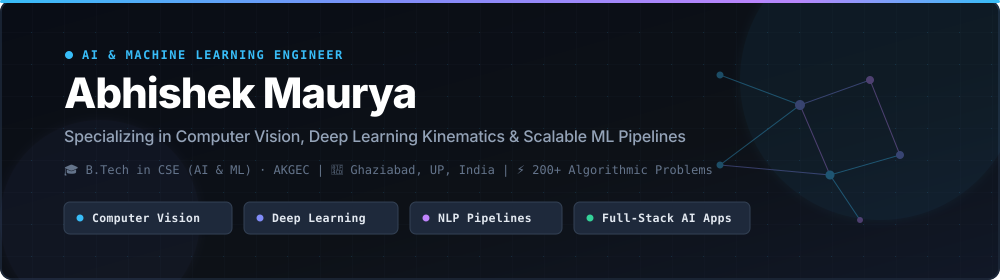

  <!-- Executive Hero Banner -->
  

    

  <!-- Dynamic Typing Headline (Optimized Width & Sizing) -->
  

  <!-- Academic Credentials & Status Row -->
  

    
    
    
    
  

  <!-- Recruiter Direct Action Links -->
  

    
    &nbsp;
    
    &nbsp;
    
    &nbsp;
    
    &nbsp;
    
  

---

## 👨‍💻 Executive Summary

Software Engineer specializing in **Artificial Intelligence, Machine Learning, and Computer Vision**. Currently pursuing a **Bachelor of Technology in Artificial Intelligence & Machine Learning (2023–2027)** at **Ajay Kumar Garg Engineering College (AKGEC), Ghaziabad** with a cumulative **CGPA of 7.38 / 10**.

- **Industry Internship Experience**: Former **Artificial Intelligence Intern at IBM Developer Skills Network**, where I developed a CNN image classifier achieving **92% validation accuracy** through data augmentation and hyperparameter tuning, regression-based salary forecasting models (+18% accuracy over baseline), and Amazon review sentiment analyzers with TF-IDF & Naive Bayes (**88% accuracy**).
- **Computer Vision & Kinematics**: Architected real-time human-computer interaction (HCI) and biomechanical posture analysis pipelines using MediaPipe (Hands & Pose), OpenCV, and custom kinematic angle calculations running under **sub-30ms latency**.
- **Algorithmic Problem Solving**: Solved **200+ Data Structures & Algorithms problems** across LeetCode and GeeksforGeeks utilizing C++ and Java, with strong focus on arrays, dynamic programming, trees, and graphs.
- **Full-Stack ML Engineering**: Engineered end-to-end data pipelines connecting machine learning inference models with modern web frameworks (Flask, FastAPI, React, RESTful APIs).

---

## 🛠️ Technical Arsenal & Competencies

| Domain | Technologies, Frameworks & Tooling |
| :--- | :--- |
| **Programming Languages** | `Python` `C++` `Java` `JavaScript (ES6+)` `SQL` `HTML5` `CSS3` |
| **Machine Learning & Deep Learning** | `Scikit-Learn` `PyTorch` `TensorFlow` `Pandas` `NumPy` `SciPy` |
| **Computer Vision & NLP** | `OpenCV` `MediaPipe (Pose & Hands)` `NLTK` `TF-IDF` `VADER` |
| **Backend & Web Frameworks** | `Flask` `FastAPI` `RESTful APIs` `React.js` `Node.js` |
| **Databases & DevOps** | `MySQL` `PostgreSQL` `MongoDB` `Git` `GitHub Actions` `Docker` `Linux` `VS Code` `Jupyter` |

 

  

---

## 🚀 Featured Engineering Projects

| Project | Architecture & Tech Stack | Key Impact & Capabilities |
| :--- | :--- | :--- |
| **[VisionMouse](https://github.com/AbhishekCodingPrograms/VisionMouse-AI-Powered-Gesture-Controlled-Virtual-Mouse)** AI Gesture-Controlled Virtual Mouse | `Python` `OpenCV` `MediaPipe Hands` `PyAutoGUI` 21-point hand landmark tracking pipeline with spatial smoothing heuristics and algorithmic velocity interpolation. | • Touchless left/right click, drag-and-drop, and scroll • **Sub-30ms latency** with zero cursor jitter • Full touchless human-computer interaction |
| **[AIFit](https://github.com/AbhishekCodingPrograms/AI-Based-Smart-Fitness-and-Preventive-Healthcare-Web-Application-Using-Computer-Vision)** Biomechanical Posture & Kinematics Analyzer | `MediaPipe Pose` `Scikit-Learn` `Flask` `React` Real-time vector angle calculations across anatomical joint vertices coupled with custom ML classification models. | • Automated rep counting for squats, push-ups, lunges • Sub-degree angular precision feedback • Real-time posture deviance warnings |
| **[FreightRate Predictor](https://github.com/AbhishekCodingPrograms/FreightRate-Predictor-Machine-Learning-Based-Freight-Cost-Prediction)** Logistics Shipping Cost Regression Pipeline | `Python` `Scikit-Learn` `Pandas` `NumPy` `Flask` End-to-end predictive regression model forecasting commercial freight tariffs with robust preprocessing & scaling. | • Benchmarked Linear Regression, Random Forest, GBDT • High prediction accuracy across cargo variables • Deployed interactive inference interface |
| **[Movie Recommender](https://github.com/AbhishekCodingPrograms/Movie-Recommender-with-Sentiment-Intelligence)** Sentiment-Aware Hybrid Recommendation Engine | `Python` `NLP` `TF-IDF` `NLTK` `Scikit-Learn` `Flask` Dual-filtering pipeline combining metadata cosine similarity on 5,000+ films with VADER review sentiment analysis. | • **88% sentiment classification accuracy** on 10,000+ reviews • **Sub-1.5s query response** with explainable metrics • Filters against negative sentiment review bias |
| **[IPL Analytics Dashboard](https://github.com/AbhishekCodingPrograms/IPL-Data-Analysis-Dashboard)** 17 Seasons Sports Analytics & Intelligence | `Python` `Pandas` `NumPy` `Matplotlib` `Seaborn` Processed and structured 17 IPL tournament seasons (2008–2025) covering 1,000+ matches and 800+ players. | • 10+ KPIs: strike rates, economy, toss influence • Generated data-driven team comparative insights • Automated visual reporting workflows |

---

## 📊 Live GitHub Activity & Analytics

<table align="center" width="100%" border="0">
  <tr>
    <td width="50%" align="center" valign="top">
      
    </td>
    <td width="50%" align="center" valign="top">
      
    </td>
  </tr>
</table>

  

---

  <h3>🤝 Let's Connect & Collaborate</h3>
  
Open for <b>Software Engineering</b>, <b>Artificial Intelligence</b>, and <b>Machine Learning</b> roles & internships.

  

    
    &nbsp;
    
    &nbsp;
    
    &nbsp;
    
  

   
  

